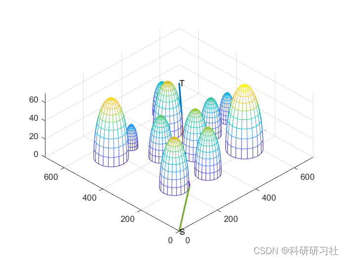
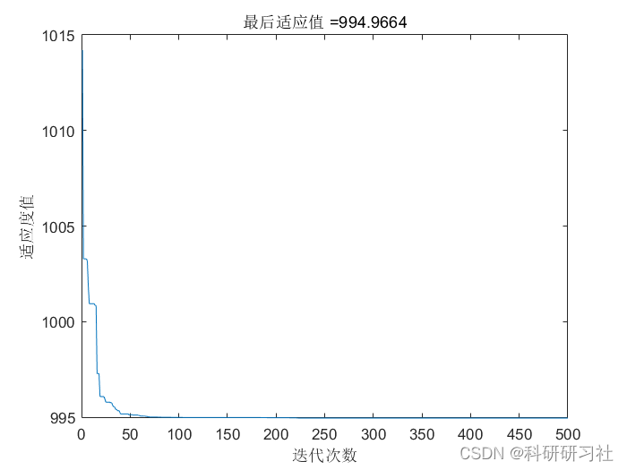

# Research on Path Planning Problem Based on Particle Swarm Algorithm (PSO) (Matlab Code Implementation)

​  
Contents
1. Overview
2. Introduction to Particle Swarm Optimization
3. Problem Analysis
4 Basic Principles
5 Running results
6. MATLAB code implementation
7 References
8. Conclusion
1. Overview
The earliest scientists discovered that biological communities exhibit regular patterns of seeking benefits and avoiding harms, as well as activities for foraging and hunting. These include the foraging behaviors of birds and fish populations, the swarming activities of bee colonies, and the family hunting actions of lions. Such biological activities were later applied to solve complex optimization problems in engineering, such as solving complex power grid planning problems, optimizing the placement of irrigation pipelines, and finding the optimal cost for constructing high-rise buildings. Genetic algorithms (BA) (in the 1960s and 1970s), particle swarm optimization (PSO) (in 1995), and differential evolution (DE) (in 1995) are some of the more familiar algorithms.
Particle Swarm Optimization (PSO) is a kind of intelligent computing algorithm proposed by J. Kennedy and R. C. Eberhart in 1995. At high speed. Clean, The high precision of the solution has quickly become widely known. The introduction of the Particle Swarm Algorithm has also created many figures in academia. Many dissertations focus on the optimization and improvement of particle swarm algorithm. The core principle is "Iterative evolution." Survival of the fittest. Particle swarm optimization algorithm is a new kind of intelligent optimization algorithm. Because it is simple in concept. Parameters are few. Easy to implement and other advantages. It has won the favor of many domestic and foreign researchers. It has been widely used in function optimization. Automatic control Machine learning, In fields such as engineering design.However, as the Particle Swarm Optimization (PSO) algorithm is still in development, its theoretical foundation and methods for improvement and application areas require further research and expansion. Path planning is one of the most fundamental aspects of mobile robot navigation, which involves searching for an optimal or near-optimal collision-free path from the initial state to the target state based on a certain performance metric (such as shortest path length, minimum usage time, or least energy consumption). Traditional path planning algorithms such as potential field method, observable layout method, genetic algorithm, etc., have their own inherent deficiencies that lead to issues such as excessive computational load, low efficiency, and poor optimization capability, failing to meet the requirements for computational efficiency and reliability in path planning.
Particle Swarm Optimization (PSO) is a type of evolutionary computation technique, similar to genetic algorithms, which is an iterative optimization tool that searches for the optimal value through iterations. Compared to genetic algorithms, PSO's advantage lies in its simplicity, ease of implementation, and the fact that many parameters do not need adjustment. Neural networks, as a highly parallel distributed system, offer possibilities for addressing the high real-time requirements of robot systems and are applied in areas such as intelligent autonomous mobile robot navigation and path planning.
4. Fundamental Principles: To address the issues of traditional path planning algorithms, this paper employs a novel intelligent algorithm for path planning. It first utilizes neural network training to calculate collision penalty functions to obtain collision-free paths, and then employs particle swarm optimization to solve the optimality issue of the path.
5. Running results editing
Editor
6. MATLAB code implementation
Research on Path Planning Problem Based on Particle Swarm Algorithm (Matlab Code Implementation)
33  
clear all\nclc\n%     for o=1:4\ntic\n%         for u=1:50\n%% Set parameters values\nstartX=0;startY=0;                            % Starting coordinates\nendX=700;endY=700;                            % End coordinates\nc1=2;\nc2=2;                     % Learning factor\nw=0.7;  % Inertia Factor\npop=20;               % Number of particles\nN_gen=500;\npopmax=700;\npopmin=0;              % Position range, determined by the test function\nVmax=20;\nVmin=-20;                 % Speed range, determined by the test function\ngridCount=30;\n%% Generate Mountains\nthreat=[304 400 0;404 320 0;440 500 0;279 310 0;560 220 0;172 527 0;....\n    194 220 0;272 522 0;350 200 0;....\n    650 400 0;740 250 0;540 375 0;510 600 0];\nr=[45 50 55 10 70 65 55 25 50 30 40 40 35];\n\nfor i=1:length(r)\n    figure(1)\n    [x,y,z]=sphere;\n    mesh(threat(i,1)+r(i)*x,threat(i,2)+r(i)*y,abs(threat(i,3)+r(i)*z));\n    hold on\nend\nview([-30,-30,70])\n%% Initialize particles\nfor i=1:pop\n    for j=1:gridCount\n        X(i,j)=startX+j*(endX-startX)/(gridCount+1);\n        Y(i,j)=startY+rand()*(endY-startY);\n        path(i,2*j-1)=X(i,j);\n        path(i,2*j)=Y(i,j);\n    end\nend\nfor i=1:pop\n    [distance,pathpoint,positionPoint]=verify(path(i,:),threat,....\n        r,startX,startY,endX,endY,gridCount);\n    fitness(i)=distance;\n    V(i,:)=5*rands(1,gridCount*2);  % Distributed within the speed range\nend\n[bestFitness,bestindex]=min(fitness);\nbestpath=path(bestindex,:);\npbest=path;\nT=std(fitness);\nBestFitness=Inf;\nglobalFitness=Inf;\npathRecord=zeros(1,gridCount+1); bestRecord=zeros(1,gridCount+1);\nposition=zeros(gridCount+1,2);\n\n%% Iterative Optimization\nfor i=1:N_gen\n    for j=1:pop\n        V(j,:)=w*V(j,:)+c1*rand*(pbest(j,:)-path(j,:))+c2*rand*(bestpath-path(j,:));  %Update speed according to the formula\n        V(j,find(V(j,:)>Vmax))=Vmax;  % Limit speed size\n        V(j,find(V(j,:)<Vmin))=Vmin;\n        \n        path(j,:)=path(j,:)+V(j,:);  % Update location according to the formula\n        path(j,find(path(j,:)>popmax))=popmax;  % Limit the size of position\n        path(j,find(path(j,:)<popmin))=popmin;\n        [distance,pathpoint,positionPoint]=verify(path(j,:),threat,....\n            r,startX,startY,endX,endY,gridCount);\n        fmin=distance;\n        if fmin<fitness(j)\n            fitness(j)=fmin;  % Update individual optimal fitness\n            pbest(j,:)=path(j,:);  % Update individual optimal value\n        end\n        \n        if fmin<bestFitness\n            bestFitness=fmin;  % Update the global optimal fitness\n            bestpath=path(j,:);  % Update the global optimal value\n            pathRecord=pathpoint;\n            position=positionPoint;\n        end\n    end\n    Fmin(i)=bestFitness;\nend\n%         end\n%     end\n%% Draw the entity diagram\nrecord=[];\ncount=1;\ni=gridCount+1;\nwhile i>1\n    j=pathRecord(i);\n    record(count,1)=position(i,1); record(count,2)=position(i,2);\n    count=count+1;\n    plot([position(i,1),position(j,1)],[position(i,2),position(j,2)],'Linewidth',2)\n    axis([0,700,0,700]);\n    i=j;\nend\nrecord(count,1)=position(i,1); record(count,2)=position(i,2);\n\ntext(position(1,1)',position(1,2)','S');\ntext(position(gridCount+1,1)',position(gridCount+1,2)','T');\nfigure(2)\nplot(Fmin);\n% title(['Best Individual Fitness Change Trend, Best Fitness=' num2str(BestFitness)])\ntitle(['Final adaptation value =' num2str(min(Fmin))]);\nxlabel('Iteration count')\nylabel('Fitness value')\n%% Analysis results\n% plot(yy);\n% title(['Fitness Curve    Optimal Fitness Value:' num2str(yy(500))]);\n% xlabel('Evolution Number');\n% ylabel('Adaptability');\n  
7 References
[1] Bai Xiaolan, Zhou Wenquan, Zhang Zhenbeng, Yuan Zheng. Robot Path Planning Based on Heuristic Particle Swarm Optimization [J]. Journal of Composite Machine Tools and Automation Technology, 2022(08):44-47+52. DOI: 10.13462/j.cnki.mmtamt.2022.08.011.
[2] Qu Wenting. Grain Yield Forecasting Method Based on Particle Swarm Optimization and RBF Neural Network Technology [D]. Henan Normal University, 2016.
[3] Wu Gaochao. Research on Path Planning Problem Based on Particle Swarm Optimization [D]. Yanshan University, 2016.

## Images

<!-- PAYMENT_BLOCK -->

## Get this dataset

- Payment link (Stripe): [Buy now](https://buy.stripe.com/3cs8yP7sY87d0vu9AB)
- Payment QR code: 

<!-- /PAYMENT_BLOCK -->
